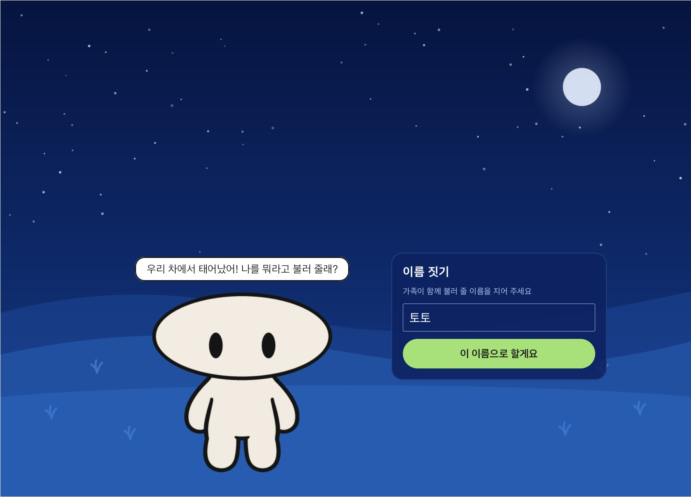
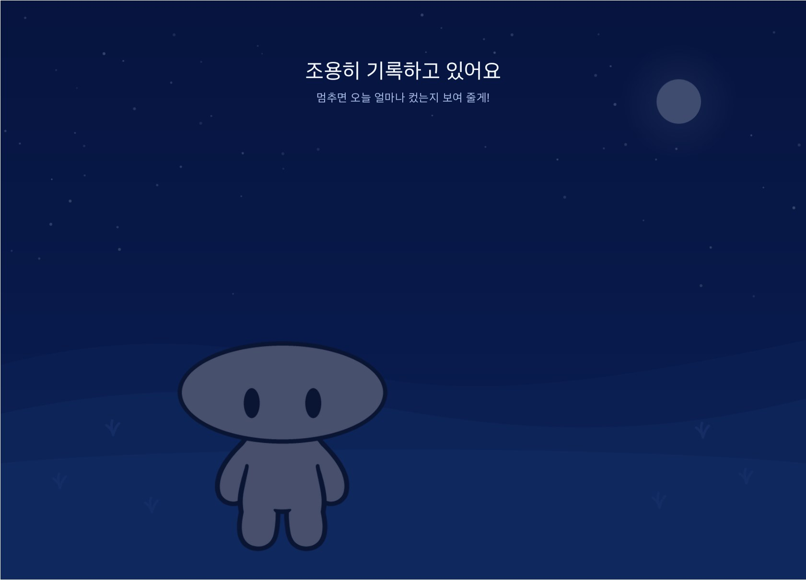
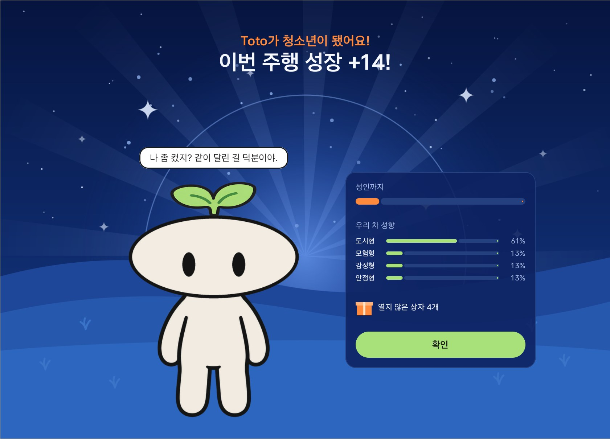
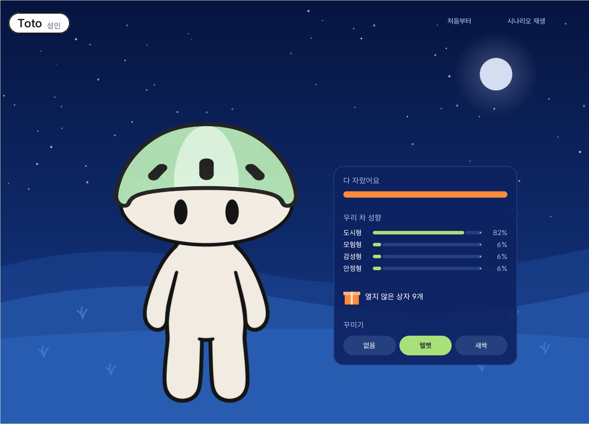

# CARSONA (카르소나)

**평소처럼 차를 타기만 하면, 우리 가족이 자주 가는 곳과 안전 운전 습관을 닮아 자라는 차량 아바타 '토토'**

현대자동차그룹 차량용 앱 개발 공모전 출품작 · 팀 **카소랩 (CarsoLab)** · Pleos Connect (Android Automotive OS)

## 시연 영상

[CARSONA 1차 프로토타입 시연 (YouTube, 1분 18초)](https://youtu.be/a2fo9NzKwLU) — 첫 만남 → 꾸미기 → 출퇴근 주행 → 청소년 → 성인

## 화면 (1차 프로토타입, Pleos Connect 에뮬레이터)

| 첫 만남 | 주행 중 (기어 D) |
|---|---|
|  |  |
| **정차 후 성장 공개 (기어 P)** | **홈: 성장·성향·상자·꾸미기** |
|  |  |

앱 구조와 SDK 사용: [docs/images/screens/architecture.png](docs/images/screens/architecture.png)

## APK

- 위치: [`apk/CarsoLab_CARSONA_release.apk`](apk/CarsoLab_CARSONA_release.apk)
- 직접 만들기: `./gradlew :app:packageContestApk` (서명 키 `keystore.properties`가 있어야 release 서명이 돼요)

## 테스트 환경

| 항목 | 값 |
|---|---|
| 에뮬레이터 | Pleos Connect Emulator **v2.1.0** (Android 14, API 34, x86_64) |
| 화면 규격 | **2560 × 1440**, 160 dpi, 가로 |
| 개발 도구 | Android Studio, Kotlin, Jetpack Compose |
| SDK | minSdk 28, targetSdk 37, Pleos Vehicle SDK `ai.pleos.playground:Vehicle:2.3.2`, Pleos TextToSpeech SDK `ai.pleos.playground:TextToSpeech:3.3.1` (ON_DEVICE) |
| 권한 | `pleos.car.permission.CAR_DRIVE`, `pleos.car.permission.CAR_LIGHTS`, `pleos.car.permission.TTS_SERVICE` |

## 실행 방법

1. Pleos Connect Emulator v2.1.0을 실행해요.
2. APK를 설치하고 실행해요: `adb install -r apk/CarsoLab_CARSONA_release.apk`
3. 첫 화면에서 아바타 이름을 지어요.
4. 차량 신호는 **Pleos Connect Virtual Console**로 바꿔요.
   - `adb forward tcp:8088 tcp:8088` 후 브라우저에서 `http://127.0.0.1:8088/` → Emulation Controls
   - 기어 **D** → 주행 중 화면 ("조용히 기록하고 있어요")
   - 주행거리(Odometer) 올리기, 방향지시등(Turn Signal) 켜기 → 성장치가 쌓여요 (화면에는 숫자를 보여주지 않아요)
   - 기어 **P** → "이번 주행 성장 +N!" 공개, 상자, 대사(화면 + 토토 목소리). 기준을 넘으면 아기 → 청소년 → 성인
5. 빠른 시연: 홈 화면 오른쪽 위 **시나리오 재생** → 출퇴근 4회(회당 +14)가 자동 재생돼 청소년이 돼요. 한 번 더 누르면 성인.
   - 홈 화면 **꾸미기**에서 헬멧·새싹을 씌울 수 있어요 (단계가 바뀌어도 유지).
   - 홈 화면 오른쪽 위 **처음부터** → 확인하면 첫 만남(이름 짓기)부터 다시 시작해요.
6. 실제 신호를 한 번에 보내려면 (Git Bash): `bash scripts/demo_trip.sh` — 기어 D → 28km·방향지시등 5회 → 기어 P, 주행 1회에 +29.

자세한 신호 정보: [docs/signal-test.md](docs/signal-test.md)

## 동작 방식

```
Pleos Vehicle SDK (기어·방향지시등·주행거리)
   → PleosVehicleSource : 공통 약속 2 이벤트 (tripStart, turnSignal, distance, smoothBrake, park)
   → GrowthEngine       : 공통 약속 1 아바타 상태 계산 (성장·성향·상자·대사 키)
   → CarsonaStore / 화면 : 첫 만남 · 홈 · 주행 중 · 성장 공개 (기어로 자동 전환)
```

- 주행 중에는 소리·애니메이션·숫자 없이 짧은 문구만 보여줘요. 성장과 토토 목소리는 정차(P) 후에만 나와요.
- 서버 없이 차 안(기기 저장소)에만 저장해요. 앱을 껐다 켜도 토토가 그대로 남아요.

## 폴더 구조

```
app/src/main/java/com/carsona/app/
 ├─ vehicle/   차량 신호 → 이벤트 (VehicleDataSource, PleosVehicleSource)
 ├─ model/     아바타 상태 (공통 약속 1), 기기 저장 (AvatarStorage)
 ├─ growth/    성장 계산 (CarsonaGrowthEngine), 시나리오 재생 (ScenarioVehicleSource)
 ├─ voice/     토토 목소리 (Pleos TextToSpeech, TotoVoice)
 └─ ui/        화면, 대사
app/src/main/res/drawable/   avatar_stage0~2.png, bg_default.png, bg_reveal.png, part_*.png
app/src/main/assets/         dialogues.json, scenarios/*.json
scripts/                     시연용 주행 스크립트
docs/                        신호 테스트, 팀 전달 문서, 디자인 원본, 영상 썸네일
```

## 알려진 제한 (1차 프로토타입)

- 실제 차량 신호로는 기어·방향지시등·주행거리만 받아요. 목적지(성향 계산용)는 1차에서 "회사"로 고정하고, 부드러운 제동은 시나리오 재생에서만 반영해요. 내비게이션 목적지 연동과 제동 감지는 2차에서 붙일 예정이에요.
- 기어를 D로 바꾸면 Pleos 시스템의 주행 카메라 화면이 잠깐 겹쳐 뜰 수 있어요. 앱이 아니라 차량 기본 기능이에요.
- 홈 화면의 "시나리오 재생", "처음부터"는 심사·시연용 버튼이에요.

## 이미지·리소스 출처

| 리소스 | 출처 |
|---|---|
| 토토 캐릭터 (아기·청소년·성인 `avatar_stage0~2.png`), 꾸미기 파츠 (헬멧·새싹 `part_*.png`) | 팀 카소랩 자체 제작. 디자이너가 태블릿에 직접 그린 원화를 바탕으로, AI 도구 ChatGPT(OpenAI)로 선과 색을 다듬었어요. OpenAI 이용약관에 따라 출력물의 소유권은 사용자에게 있어요. 얼굴의 타원형은 현대자동차 엠블럼의 타원 형태에서 아이디어를 얻은 자체 디자인이며, 실제 로고·상표는 사용하지 않았어요. |
| 배경 (밤하늘 `bg_default.png`, 성장 공개 `bg_reveal.png`) | 팀 카소랩 디자이너가 정한 배경 콘셉트(밤하늘, 언덕, 성장 순간의 빛줄기)를 AI 도구 Claude(Anthropic)에 설명해 생성한 이미지예요. Anthropic 이용약관에 따라 생성 결과물의 권리는 사용자에게 있어요. 다른 사람의 작품이나 로고·상표는 사용하지 않았어요. |
| 시연 영상 썸네일 (`docs/images/thumbnail/`) | 위 토토·배경 이미지로 팀 카소랩이 직접 구성. 글꼴은 Noto Sans KR (SIL Open Font License) |
| 대사, 시나리오 (`dialogues.json`, `scenarios/*.json`) | 팀 카소랩 자체 작성 |
| 차량 신호·음성 | Pleos Playground 공식 SDK (Vehicle 2.3.2, TextToSpeech 3.3.1) |
| 오픈소스 라이브러리 | Android Jetpack (AndroidX Core·Activity·Lifecycle, Jetpack Compose, Material 3), Kotlin 표준 라이브러리, Gradle Wrapper — 모두 Apache License 2.0. 라이선스 원문: https://www.apache.org/licenses/LICENSE-2.0 |
